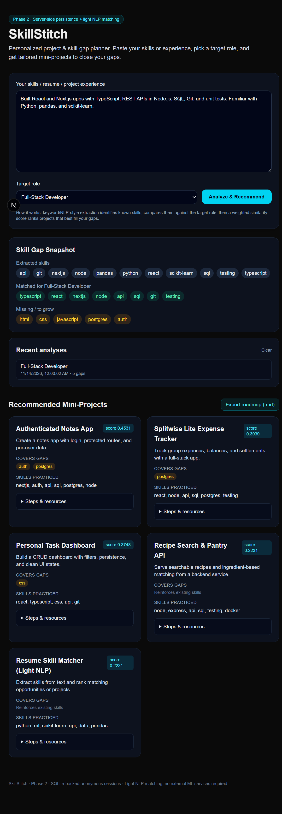
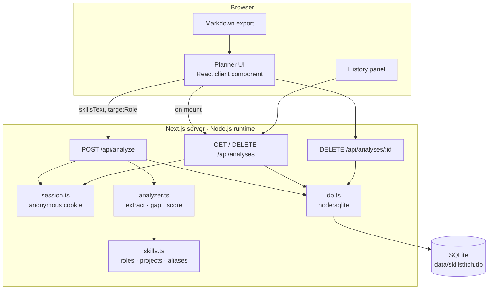
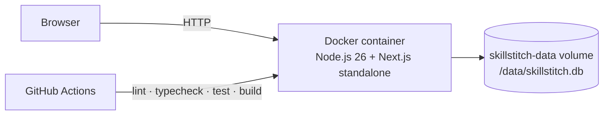

# SkillStitch

**Personalized project & skill-gap planner** — paste your skills, resume, or project experience, pick a target role, and get a tailored set of mini-projects that close your gaps.

> **Status:** MVP complete (Phases 1–2) · updated November 2026 · Node.js 22.5+

   [](https://github.com/jainluv1524-cpu/skillstitch/actions/workflows/ci.yml)

## Why

Most learning roadmaps are generic. SkillStitch makes the plan **personal**:

1. Extract known skills from free text (resume, bio, project notes).
2. Compare them against a target role profile.
3. Rank mini-projects by how well they fill the biggest gaps.



## Features

### Phase 1 — analysis & recommendations
- **Skill extraction** from free text using tokenization, alias normalization, and a curated skill taxonomy.
- **Role profiles** for Frontend, Backend, Full-Stack, and ML-aware Full-Stack paths.
- **Gap analysis**: matched skills vs. missing skills for the selected role.
- **Weighted project recommendations**: coverage, similarity, feasibility, and gap-focus scoring.
- **Actionable project cards** with steps and resource pointers.
- **Markdown roadmap export**.
- Clean, responsive dark UI with Tailwind CSS.

### Phase 2 — persistence
- **Server-side saved analyses** using SQLite (Node's built-in `node:sqlite`).
- **Anonymous cookie sessions** — no signup needed for the MVP.
- **History panel** showing your last 10 analyses, with restore and clear actions.
- **REST endpoints** for listing and deleting analyses.
- No native modules or external database service required.

## Tech stack

| Layer | Choice |
| --- | --- |
| Framework | Next.js (App Router) |
| Language | TypeScript |
| UI | React + Tailwind CSS |
| API | Next.js Route Handlers |
| Database | SQLite via `node:sqlite` (Node 22.5+) |
| "ML" | Lightweight NLP: tokenization, alias matching, weighted cosine similarity |

## Architecture

### System overview



### Components

| Component | Responsibility |
| --- | --- |
| `src/app/page.tsx` | Client UI: input, role picker, gap snapshot, recommendations, history, export |
| `src/app/api/analyze/route.ts` | Validates input, runs analysis, saves the result, returns the saved id |
| `src/app/api/analyses/route.ts` | Lists or clears analyses for the current session |
| `src/app/api/analyses/[id]/route.ts` | Deletes a single analysis with an ownership check |
| `src/lib/analyzer.ts` | Tokenization, skill extraction, gap analysis, weighted cosine scoring |
| `src/lib/skills.ts` | Role profiles, project catalog, aliases, normalization |
| `src/lib/session.ts` | Reads/sets the `skillstitch_uid` anonymous session cookie |
| `src/lib/db.ts` | SQLite connection, schema creation, user/analysis queries |
| `scripts/*` | Analyzer and in-memory SQLite smoke tests |
| `Dockerfile` / `docker-compose.yml` | Node.js standalone deployment with a persistent volume |
| `.github/workflows/ci.yml` | Lint, type-check, tests, and production build |

### Analysis request flow

1. The browser sends `{ skillsText, targetRole }` to `POST /api/analyze`.
2. The route validates the input and resolves the anonymous session cookie.
3. `analyzer.ts` tokenizes the text, normalizes aliases, extracts known skills, and compares them with the role profile.
4. Each project is scored by gap coverage, cosine similarity, known-skill overlap, and gap focus.
5. `db.ts` saves the analysis and returns the ranked recommendations plus a saved id.

### History request flow

1. On mount, the page calls `GET /api/analyses`.
2. `session.ts` resolves the `skillstitch_uid` cookie to a user id.
3. `db.ts` returns the latest 10 analyses for that user.
4. Clearing calls `DELETE /api/analyses`; restoring is handled in client state.
5. Deleting one entry calls `DELETE /api/analyses/:id`, which checks ownership before deleting.

### Deployment topology



## Getting started

Requires **Node.js 22.5+** (tested on Node 26).

```bash
npm install
npm run dev
```

Open [http://localhost:3000](http://localhost:3000).

The SQLite database is created automatically at `data/skillstitch.db` on first use. Override it with:

```bash
SKILLSTITCH_DB_PATH=/path/to/skillstitch.db npm run dev
```

### Scripts

```bash
npm run dev       # start the dev server
npm run build     # production build
npm run start     # run the production build
npm run lint      # lint
npm run typecheck # type-check
npm test          # analyzer smoke test
```

## API

| Method | Route | Purpose |
| --- | --- | --- |
| `POST` | `/api/analyze` | Analyze skills and save the result for the current anonymous session |
| `GET` | `/api/analyses` | List the current session's saved analyses (latest 10) |
| `DELETE` | `/api/analyses` | Clear all analyses for the current session |
| `DELETE` | `/api/analyses/:id` | Delete one analysis owned by the current session |

Example:

```bash
curl -X POST http://localhost:3000/api/analyze \
  -H "Content-Type: application/json" \
  -d '{"skillsText":"React, TypeScript, Node.js, SQL, Git","targetRole":"fullstack"}'
```

## How it works

```
Free text ──► tokenize + normalize aliases ──► known-skill set
                                                   │
Target role ──► required skills ──► matched / missing gaps
                                                   │
                                                   ▼
                              weighted similarity scoring over project ideas
                                                   │
                                                   ▼
                                   ranked recommendations + next steps
                                                   │
                                                   ▼
                         saved to SQLite for the anonymous session
```

The recommendation score is intentionally lightweight and explainable:

- `coverage` — how many of your missing skills a project covers (highest weight).
- `known` — how much of the project you can already build with current skills.
- `similarity` — cosine similarity between your skill vector and each project's skill vector.
- `focus` — how concentrated a project is on your gaps rather than unrelated skills.

## Data model

```sql
users (
  id TEXT PRIMARY KEY,
  created_at TEXT NOT NULL
)

analyses (
  id TEXT PRIMARY KEY,
  user_id TEXT NOT NULL REFERENCES users(id) ON DELETE CASCADE,
  skills_text TEXT NOT NULL,
  target_role TEXT NOT NULL,
  result_json TEXT NOT NULL,
  created_at TEXT NOT NULL
)
```

## Project structure

```
src/
├── app/
│   ├── api/
│   │   ├── analyze/route.ts        # analyze + save
│   │   └── analyses/
│   │       ├── route.ts            # list / clear saved analyses
│   │       └── [id]/route.ts       # delete one analysis
│   ├── layout.tsx                  # root layout + metadata
│   └── page.tsx                    # interactive planner UI
└── lib/
    ├── analyzer.ts                 # extraction, gap analysis, scoring
    ├── db.ts                       # node:sqlite connection + queries
    ├── session.ts                  # anonymous cookie session
    └── skills.ts                   # roles, projects, aliases, normalization

scripts/
├── smoke.ts                        # analyzer smoke test
└── db-smoke.ts                     # in-memory SQLite smoke test

Dockerfile / docker-compose.yml     # self-hosted Node.js deployment
.github/workflows/ci.yml            # lint, typecheck, tests, build
```

## Deploy

### Docker (recommended for SQLite persistence)

The image builds the Next.js standalone server and runs it on Node.js.

```bash
docker compose up --build
```

The SQLite database is stored in the `skillstitch-data` volume at `/data/skillstitch.db`, so saved analyses survive container restarts.

Or without Compose:

```bash
docker build -t skillstitch .
docker run -p 3000:3000 -v skillstitch-data:/data skillstitch
```

### Node.js directly

```bash
npm ci
npm run build
SKILLSTITCH_DB_PATH=./data/skillstitch.db npm start
```

> SQLite is ideal for local development and single-instance self-hosting. For serverless platforms with ephemeral filesystems, replace `src/lib/db.ts` with Postgres or another managed database while keeping the API shape.

## CI

GitHub Actions runs lint, type-check, smoke tests, and a production build on every push and pull request to `main`.

## Roadmap

- [x] Phase 1 — MVP: skill extraction, gap analysis, recommendations, history/export
- [x] Phase 2 — Persistence: SQLite-backed analyses, anonymous sessions, history panel
- [ ] Phase 2b — Accounts: real auth, cross-device profiles, per-user progress tracking
- [ ] Phase 3 — Smarter matching: embeddings/classifier-based extraction and ranking
- [ ] Phase 4 — Imports: resume PDF and GitHub profile ingestion
- [ ] Phase 5 — Polish & deploy: tests, accessibility pass, CI, production deployment

> Note: SQLite is ideal for local development and single-instance self-hosting. For serverless production, swap `src/lib/db.ts` for Postgres (or another managed database) while keeping the API shape.

## License

**No license.** This project is shared for viewing and educational purposes. All rights reserved by the author.
